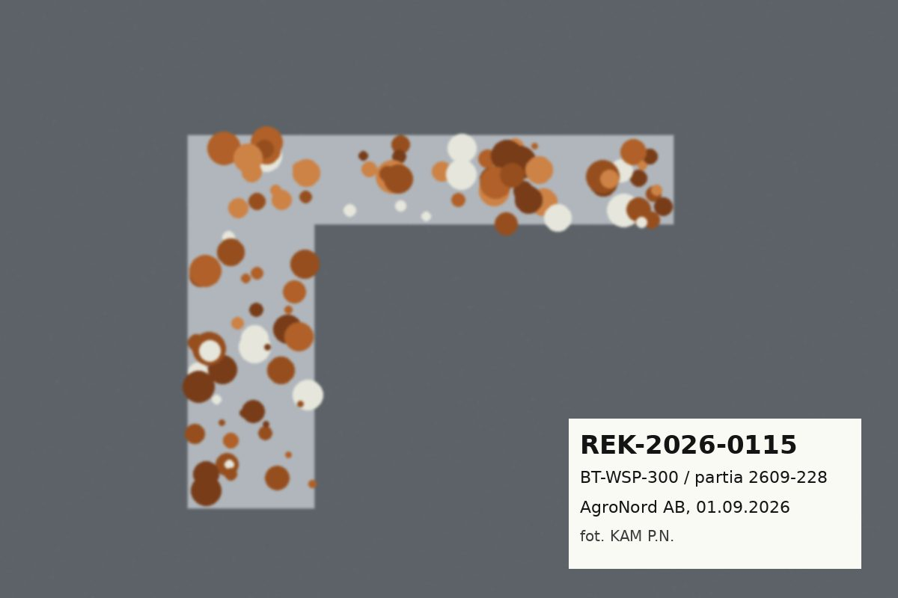

# Opis zdjęcia: korozja wspornika BT-WSP-300 (reklamacja REK-2026-0115)

**Co widać:** wspornik spawany BT-WSP-300 (ocynk ogniowy) z licznymi ogniskami rdzy (rude plamy) i białym nalotem cynkowym na całej powierzchni ramion. Etykieta: REK-2026-0115, partia 2609-228, AgroNord AB, 01.09.2026, zdjęcie wykonał KAM Piotr Nowicki.

**Dlaczego ważne:** typowy obraz wady z serii reklamacji korozyjnych w Q3 2026 (14 zgłoszeń: patrz ZR-PROT-2026-Q3). Prawdopodobna przyczyna: zbyt cienka powłoka u podwykonawcy (Cynkownia Podlaska).

**Słowa kluczowe:** korozja, rdza, nalot cynkowy, white rust, ocynk, wspornik, BT-WSP-300.
