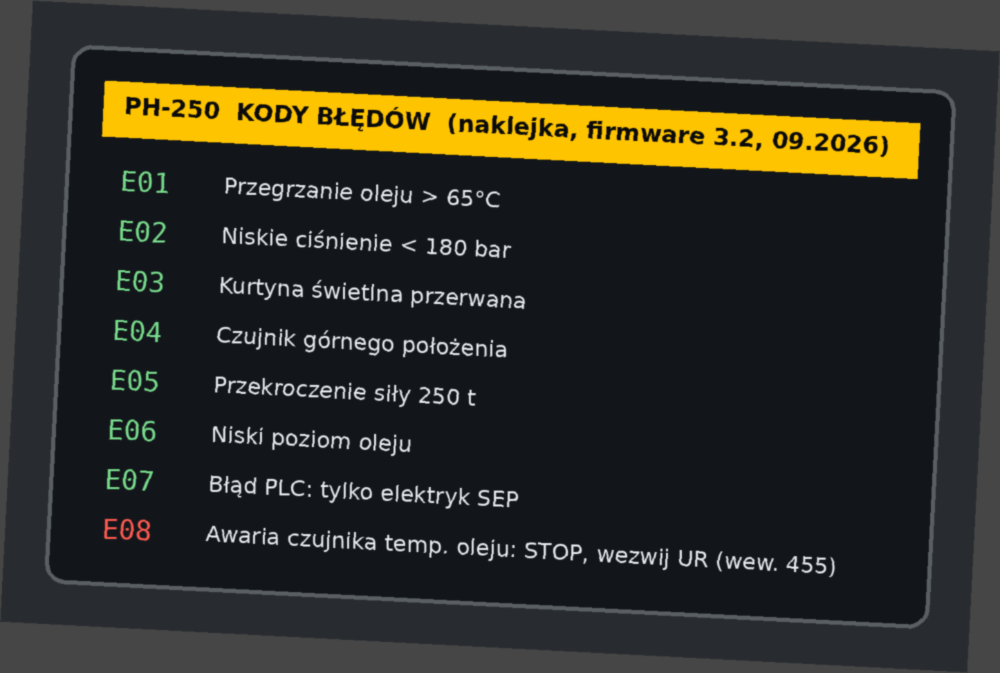

# Kody błędów z panelu prasy PH-250, firmware 3.2 (transkrypcja zdjęcia)

Transkrypcja naklejki na panelu (firmware 3.2, wrzesień 2026). Kody E01-E07: szczegóły w UR-INS-08.

| Kod | Znaczenie (z naklejki) |
|---|---|
| E01 | Przegrzanie oleju > 65°C |
| E02 | Niskie ciśnienie < 180 bar |
| E03 | Kurtyna świetlna przerwana |
| E04 | Czujnik górnego położenia |
| E05 | Przekroczenie siły 250 t |
| E06 | Niski poziom oleju |
| E07 | Błąd PLC: tylko elektryk SEP |
| **E08** | **Awaria czujnika temperatury oleju: STOP, wezwij UR (wewn. 455)** |

Kod E08 pojawił się z aktualizacją firmware 3.2. Od 12.11.2026 jest w instrukcji UR-INS-08 v2.4 §3.
